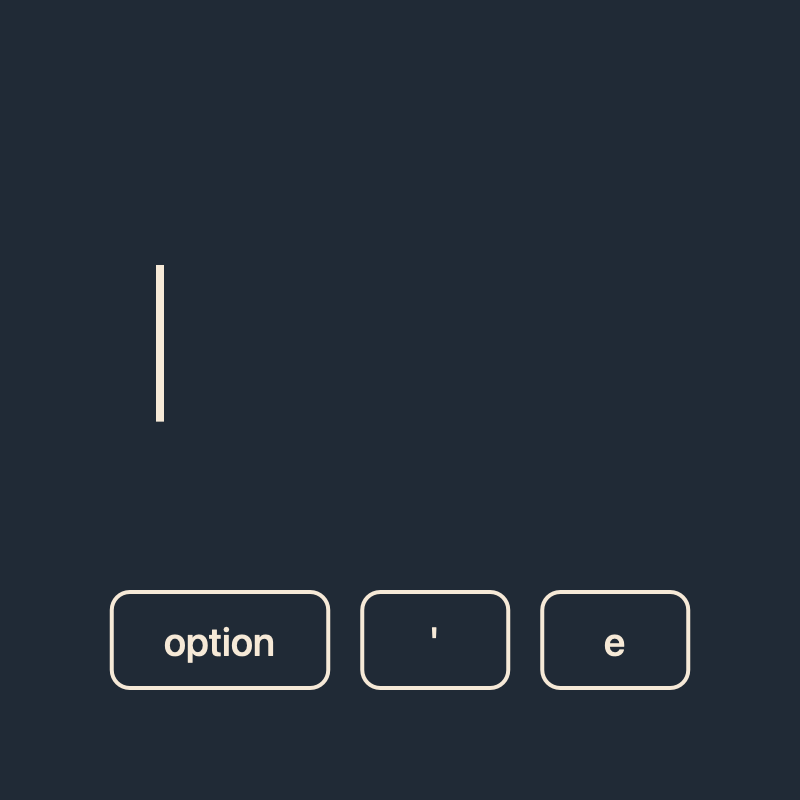

# mac-compose

A Compose key for macOS, like the one on Linux and in WinCompose. Tap the Compose key, type a few characters, get the symbol: `' e` gives é, `- >` gives →.

It runs in the menu bar and works in any app.

<p align="center"></p>

## Install

You need macOS 27.2 or later on Apple silicon.

```sh
brew install --cask adericbourg/tap/mac-compose
```

To test the latest `main`, install the daily build `mac-compose-nightly` instead. It's the same app, so it replaces `mac-compose` and keeps its permission and settings:

```sh
brew uninstall --cask mac-compose
brew install --cask adericbourg/tap/mac-compose-nightly
```

The app is self-signed and not notarized, so Gatekeeper would refuse to open it. The cask removes the quarantine attribute after installing, so installing from the tap means trusting it to bypass Gatekeeper for this app.

To install by hand instead:

1. Download the zip from the [releases page](https://github.com/adericbourg/mac-compose/releases).
2. Move `MacCompose.app` to `/Applications`.
3. Remove the quarantine attribute:

```sh
xattr -d com.apple.quarantine /Applications/MacCompose.app
```

## First launch

1. Open MacCompose. A keyboard icon appears in the menu bar.
2. Grant the Accessibility permission in System Settings → Privacy & Security → Accessibility. The app needs it to read your keystrokes and type the result. Until you do, the menu shows "Accessibility permission needed". Composing starts as soon as the permission is granted.

## Use

1. Tap the Compose key alone, without holding it with another key. The default is Right Option. The menu bar icon changes while you compose, and the keys typed so far appear next to it (`⎄` stands for a Compose press). With "Compose while held" on, you can also keep it held while typing the sequence.
2. Type the sequence, one key at a time.

| Keys | Result |
|---|---|
| `' e` | é |
| `- >` | → |
| `o o` | ° |
| Compose, Compose, then `sob` | 😭 |

Emoji are Compose, Compose, then the emoji's English name or the start of any word in it. The emoji comes as soon as no other name starts with what you typed (`sob` gives 😭 right away), otherwise after a 1 s pause, or right away on Return or Tab: `wink`, `winking face` or even `wniking` all give 😉, and `joy` gives 😂. GitHub and Slack short names work too: `sob` gives 😭, `+1` gives 👍. Typos are allowed in longer names. If several emoji match, the shortest name wins. If nothing is close, it beeps. To find any sequence, pick "Show sequences…" in the menu and search by result (`é`), name (`arrow`) or keys (`'e`). The list includes your `~/.XCompose` rules.

Escape, a mouse click or 5 s without a key cancels. A sequence that doesn't exist beeps and is dropped. Holding the Compose key with another key still works as a normal modifier, unless "Compose while held" is on: the Compose key then no longer works as a modifier at all. For example, with Right Option as the Compose key, it no longer types Option characters or does Option+arrow; with Right Command, it no longer triggers shortcuts. Its left twin keeps working.

The menu bar menu has:

| Item | Result |
|---|---|
| Enabled | Turns composing on or off |
| Compose key | Right Option (default), Right Command or Right Control |
| Compose while held | Holding the Compose key while typing composes too, like on Linux. Off by default |
| Launch at login | Starts the app when you log in. Turned on the first time the app runs; untick it to keep it off. Only works from the app bundle |
| Reload sequences | Reads `~/.XCompose` again |
| Show sequences… | Lists every sequence, with a search field |
| Version | The version and commit you are running. Include them when you report a bug |
| Quit | Quits the app |

## Use Caps Lock as the Compose key

Remap Caps Lock to Right Control, then pick "Right Control" in the menu. A remapped Caps Lock no longer toggles caps.

Do not use System Settings → Keyboard → Modifier Keys → "Caps Lock → Control". It produces Left Control, which the app does not offer.

1. Remap the key:

```sh
hidutil property --set '{"UserKeyMapping":[{"HIDKeyboardModifierMappingSrc":0x700000039,"HIDKeyboardModifierMappingDst":0x7000000E4}]}'
```

2. Pick "Compose key" → "Right Control" in the menu.

The mapping is lost at reboot. To restore it at each login, save this as `~/Library/LaunchAgents/<reverse-dns>.capslock-compose.plist`, for example `com.example.capslock-compose.plist`. It takes effect at the next login:

```xml
<?xml version="1.0" encoding="UTF-8"?>
<!DOCTYPE plist PUBLIC "-//Apple//DTD PLIST 1.0//EN" "http://www.apple.com/DTDs/PropertyList-1.0.dtd">
<plist version="1.0">
<dict>
    <key>Label</key>
    <string>com.example.capslock-compose</string>
    <key>ProgramArguments</key>
    <array>
        <string>/usr/bin/hidutil</string>
        <string>property</string>
        <string>--set</string>
        <string>{"UserKeyMapping":[{"HIDKeyboardModifierMappingSrc":0x700000039,"HIDKeyboardModifierMappingDst":0x7000000E4}]}</string>
    </array>
    <key>RunAtLoad</key>
    <true/>
</dict>
</plist>
```

To undo, clear the mapping and delete the plist:

```sh
hidutil property --set '{"UserKeyMapping":[]}'
rm ~/Library/LaunchAgents/<reverse-dns>.capslock-compose.plist
```

The `hidutil` commands were tested; the LaunchAgent was not. `hidutil` replaces every mapping you set, so merge this one into any existing `UserKeyMapping`.

## Custom sequences

Add rules to `~/.XCompose`, in the X11 format:

```
<Multi_key> <x> <x> : "✗"
```

Then pick "Reload sequences" in the menu.

For your own names, like the emoji names, start the rule with two `<Multi_key>`, then one `<x>` per character (`<space>` for a space). This one is Compose, Compose, then `shrug`:

```
<Multi_key> <Multi_key> <s> <h> <r> <u> <g> : "¯\\_(ツ)_/¯"
```

Write `\"` for a quote and `\\` for a backslash in the result.

- Your rules are loaded after the default ones, and a later rule replaces an earlier one with the same keys.
- A name you define wins over an emoji name that is the same (`shrug` above no longer gives 🤷). It must be typed exactly: no typos or word starts, unlike emoji names. While what you typed is still the start of one of your names, the 1 s pause doesn't pick an emoji: press Return.
- `include "%L"` lines are ignored: the default sequences are always loaded first.

## Default sequences

The Xorg `en_US.UTF-8` Compose rules, plus the [WinCompose](https://github.com/samhocevar/wincompose) rules and emoji, and the [gemoji](https://github.com/github/gemoji) short names. A few extra names, such as `tflip` for (╯°□°)╯︵ ┻━┻, are in [Extra.txt](Sources/MacComposeCore/Resources/Extra.txt). Sources and licenses are in [NOTICE](Sources/MacComposeCore/Resources/NOTICE).

## Known limits

- `KP_*` rules are skipped on purpose: 108 of the Xorg rules. A keypad key types the same character as the main row.
- Rules with a dead key that has no character mapped (`dead_belowdot`, `dead_dasia`, `dead_horn`, `dead_psili`) are skipped: 240 of the Xorg rules.
- `~/.XCompose`: modifier lines (`~Ctrl`, `!`) are skipped and logged, and `$XCOMPOSEFILE` is not read.
- The Compose key is Right Option, Right Command or Right Control. To use Caps Lock, [remap it to Right Control](#use-caps-lock-as-the-compose-key).
- Apple silicon only, macOS 27.2 or later.

Each limit, with the planned fix, is in the [backlog](docs/BACKLOG.md).

## Uninstall

```sh
brew uninstall --cask mac-compose
```

## More

- [Development](docs/DEVELOPMENT.md): build from source and release
- [Backlog](docs/BACKLOG.md): known limits

## License

[GPLv3](LICENSE)
